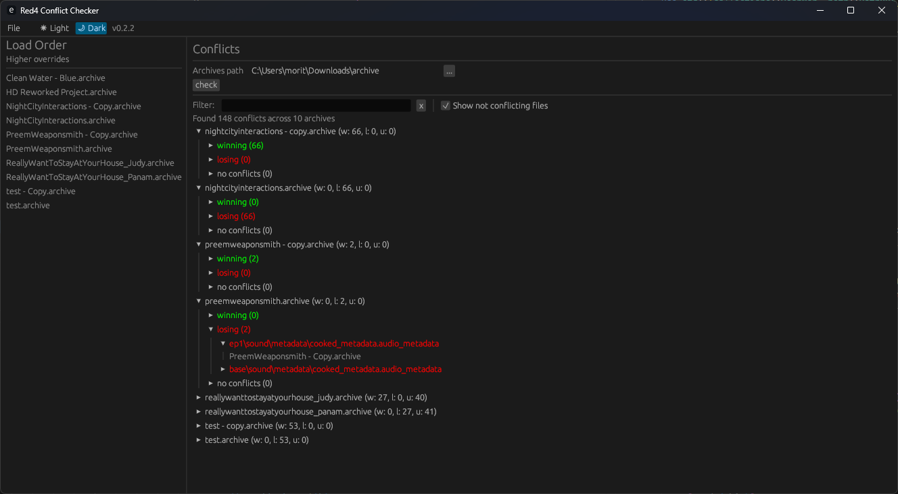
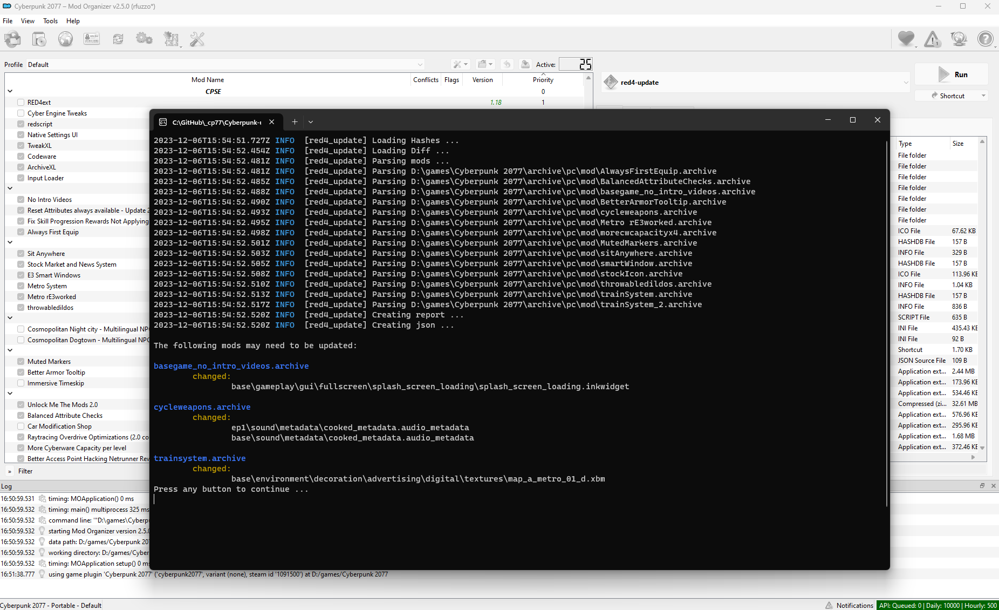

[](https://github.com/rfuzzo/Cyberpunk-utility/actions/workflows/rust.yml)

# Cyberpunk-utility

Some utility tools for Cyberpunk 2077 modding.

## RED4-Conflicts

> Nexus Mods link: https://www.nexusmods.com/cyberpunk2077/mods/11126

A conflict-checker app for Cyberpunk 2077 archives. Available as both a GUI app and a headless CLI tool.

### Using the GUI
- download and extract
- run `red4-conflicts.exe` and specify a folder with archives to check

### Using the CLI

The CLI outputs structured JSON for use with LLMs or other tools. It auto-detects your game installation (Steam/GOG).

```cmd
Usage: red4-conflicts-cli.exe [OPTIONS] [ARCHIVE_PATH]

Options:
      --pretty                  Pretty-print the JSON output
      --toon                    Output in TOON format (experimental, fewer tokens for LLM input)
      --summary                 Compact overview instead of full report
      --mod-filter <PATTERN>    Filter archives by name (supports regex)
      --file-filter <PATTERN>   Filter files by path (supports regex)
      --show-no-conflicts       Include non-conflicting files
      --show-load-order         Include the full load order list
  -h, --help                    Print help
```

```cmd
# Get a summary of all conflicts
red4-conflicts-cli --summary --pretty

# Filter for a specific mod
red4-conflicts-cli --mod-filter "ArchiveXL" --pretty

# Save full report to file
red4-conflicts-cli --pretty > conflicts.json
```

### Screenshots


## RED4-Update

A commandline tool to check if a mod needs an update after a game patch

### Usage
- download and extract
- run `red4-update.exe` and specify a folder with archives to check (or run it from within that folder)

```cmd
Usage: red4-update.exe check [PATH]

Arguments:
  [PATH]  Path to a folder with archives to check

Options:
  -h, --help  Print help
```

### Screenshots


## Cyberpunk-Tweak Util
A small app to display various tweak-related info.

### Usage
- download and extract
- run `red4-tweak_browser.exe` and 
- fill in the path to the REDmod tweak sources when prompted (e.g. `D:\games\Cyberpunk 2077\tools\redmod\tweaks`) 
- hit "Generate" when prompted

### Screenshots


## Tweak-Doxygen

A small rust utility to convert and strip tweak records (<https://github.com/CDPR-Modding-Documentation/Cyberpunk-Tweaks>) to a c# class hierarchy for use with doxygen: <https://cdpr-modding-documentation.github.io/Cyberpunk-Tweaks/>

### Usage
```cmd
tweakdox <SOURCE> <OUT>
```
